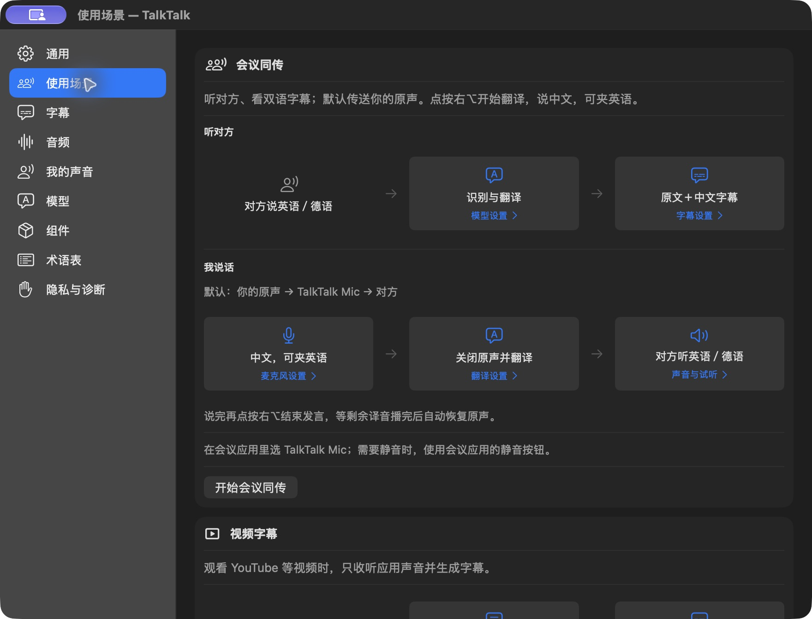
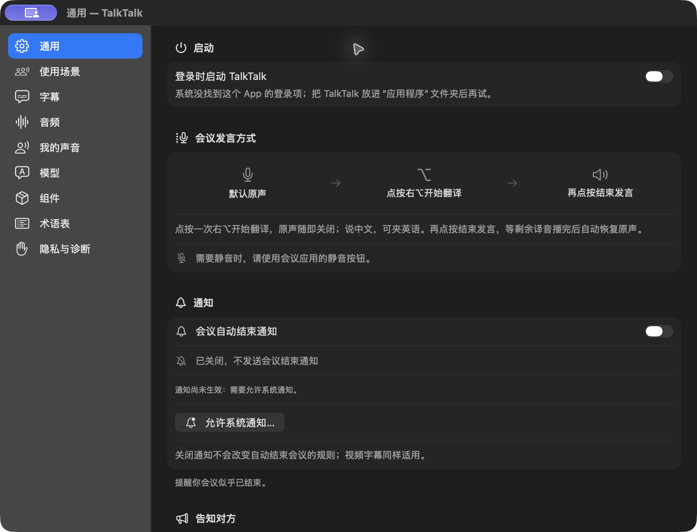

# TalkTalk



**让中文使用者更轻松地参与英语、德语会议，也能给视频加上双语字幕。**

TalkTalk 是一个原生 macOS 菜单栏应用。语音识别和语音合成在本机运行，文字翻译可选 OpenAI 或 Apple。

## 能做什么

- **听会议、看视频**：中文、英语、德语之间互译，原文与译文同时显示。会议用句对时间线，视频用扁宽字幕条；字幕可移动、缩放，语言可随时切换。
- **用中文发言**：会议中默认发送原声；点按 **右 ⌥** 开始翻译，说中文（可夹英语），再点按结束。剩余英语或德语译音播完后，自动恢复原声。
- **用自己的声音**：本地录制声音档案，由 Qwen 合成译音；会议软件选择 **TalkTalk Mic** 虚拟麦克风接收声音。

## 开始使用

需要 **Apple Silicon Mac、macOS 26.4 或更新版本**。会议同传请使用耳机。

**[下载 TalkTalk 1.0.14（macOS arm64 ZIP）](https://github.com/aaajiao/talktalk/releases/download/v1.0.14/TalkTalk-1.0.14-macOS-arm64.zip)** · [版本说明](https://github.com/aaajiao/talktalk/releases/tag/v1.0.14)

解压后将 `TalkTalk.app` 拖入“应用程序”，从 Finder 打开。该包使用 **ad-hoc 本地签名，尚无 Developer ID 签名及 Apple 公证**；首次打开时 macOS 可能显示安全提示或阻止启动，请确认下载来源后按系统提示处理。

1. 按首次引导授权，安装语音引擎及会议所需的虚拟麦克风。
2. 新机器会按需下载私有 Python 环境和 Qwen 模型；默认模型约 **4.1 GB**，另需运行环境空间。**无需自行安装系统 Python 或 Homebrew**。资产保存在 `~/Library/Application Support/TalkTalk/engine`，后续升级会复用兼容的运行时和模型。
3. 从菜单或“使用场景”设置选择用途，再在对应页面选择应用和语言：会议和视频分别记住声音来源；电话固定使用 **Phone**。会议/电话应用的输入选择 **TalkTalk Mic** 或跟随系统默认。电话模式先准备就绪，再拨号或接听；系统 Phone 负责挂断，TalkTalk 的“结束电话同传”负责停止翻译和恢复输入。（独立电话模式见当前源码；下载版仍为 1.0.14。）
4. 如需云端翻译，在设置里填写自己的 OpenAI API key；Apple 本地翻译需要先安装相应语言资源。

当前源码使用专用 **CPython 3.14.10**。App 包含引擎代码与安装器，解释器和依赖由 App 自动安装到上述私有目录，虚拟环境不读取系统 Python 包；不是将 Python 二进制直接放进 `.app`。

会议、电话和视频的收听字幕都支持中文、英语、德语六方向互译；在使用场景流程图或字幕浮窗中分别选原文与译文语言，三个场景独立保存。字幕设置页负责预览和外观。视频字幕默认只收听所选应用，不启用你的麦克风；显式开启全局备用时会收听所有应用声音。会议中的静音仍由会议软件控制；停止同传或退出 TalkTalk 时会自动还原它管理的系统输入。

当前源码提供中英文界面。设置 › 通用 › 界面语言可选“跟随系统／English／中文”，选择后立即生效。默认跟随系统首选语言：中文使用中文，其余语言使用英文；不影响会议、发言和字幕的语言选择。

**从源码构建**需要 Xcode Command Line Tools（Swift 6.2+）：

```bash
git clone https://github.com/aaajiao/talktalk.git
cd talktalk
scripts/setup-dev-python.sh
scripts/check.sh --skip-stress
scripts/build-app.sh release
```

开发环境使用仓库内 `.venv`，解释器固定在 `.build/dev-python`；Python 版本由 `.python-version` 与安装器共用的 pins 同步，依赖使用 App 相同的两份锁文件。开发时可执行 `source .venv/bin/activate`，或直接用 `.venv/bin/python3`。检查与打包脚本会验证并使用该环境，不借用已安装 App 的运行时；缺失或版本不符时会提示重新运行 setup。

`scripts/check.sh` 为每次运行创建独立临时目录，成功、失败或 Ctrl-C／TERM 结束后自动清理。Swift 文件夹具使用测试专用的 `@Suite(.temporaryFiles)` 与 `TestTemporaryDirectory.make(prefix:)`，直接运行 `swift test` 也会在每个测试结束时清理；异步任务和子进程应先等待退出。新测试请沿用该方式，Python 使用 `TemporaryDirectory` 配合 `addCleanup`／上下文管理器。清理只针对该次测试创建的文件，不扫描用户模型或声音目录。

生成的正式应用位于 `build/TalkTalk.app`，安装和启动方式同上。每次运行打包脚本都会自动递增构建号（例如 `1.0.15 (30)` 中的 `30`），并同步 `scripts/lib/versions.sh` 与生成的 `EnginePins.swift`；正式发布版本号单独维护。

## 模型与隐私

当前源码的语音资源提供三种本地组合（模型文件体积，不含运行时）：

| 档位 | 语音合成 | 语音识别 | 文件体积 |
|---|---|---|---:|
| Max | Qwen3-TTS 1.7B | Qwen3-ASR 1.7B | 5.6 GB |
| 标准（默认） | Qwen3-TTS 1.7B | Qwen3-ASR 0.6B | 4.1 GB |
| 轻量 | Qwen3-TTS 0.6B | Qwen3-ASR 0.6B | 3.0 GB |

本地 Qwen 模型均采用当前固定的 8bit 版本。档位下方的两张卡显示所需识别与合成模型，用状态图标区分已就绪与待下载。旧 Max 若实际使用 1.7B 合成＋0.6B 识别，会显示为“标准”，保留已有模型；选择另一档并确认换档后才会安装对应组合。

Apple Speech 在“识别与翻译”中独立选择，“听对方”和“我说话”各自保存选择。选择 Apple 不调用本地模型安装器，也不更换合成模型。旧的仅语音合成安装保持兼容。已有模型可在空闲时点击红色删除图标，确认后移除；当前角色被删除时不会自动改用另一个已下载模型。

| 环节 | 使用的模型或服务 |
|---|---|
| 声音 → 原文 | 本地 Qwen3-ASR；Apple Speech 可选及备用 |
| 原文 → 译文 | OpenAI（可选，需自己的 key）或 Apple Translation |
| 译文 → 声音 | 本地 Qwen3-TTS「我的声音」；可选 macOS 系统声音 |

音频和声音档案在本机处理。启用 OpenAI 时，会发送原文、翻译上下文及术语表；key 保存在 macOS 钥匙串。默认不保存会议录音或转写，文字分析和诊断录音需主动开启。系统声音与第三方组件受各自许可约束，详见[许可说明](docs/decisions/licensing.md)。

## 设置页面

使用场景见页首；点击下方分类展开其他设置页面。

<details>
<summary>通用</summary>



</details>

<details>
<summary>字幕：会议同传与视频字幕</summary>

两种场景分别保存字号、背景透明度、窗口尺寸和位置，共用“显示字幕”开关。


</details>

<details>
<summary>音频</summary>


</details>

<details>
<summary>我的声音</summary>


</details>

<details>
<summary>模型：识别、翻译与合成</summary>


</details>

<details>
<summary>组件：语音引擎与虚拟麦克风</summary>


</details>

<details>
<summary>术语表</summary>


</details>

<details>
<summary>隐私与诊断：数据、字幕分析与故障检查</summary>


</details>

## 开发与状态

本机试说、声音录入与试听已有真实验证；1.0.13 的自然长发言音色改善和 1.0.14 的末句不再重复已获用户确认。跨应用、跨设备会议及故障恢复仍有待覆盖，具体范围见验收状态。

- [架构与开发约束](docs/ARCHITECTURE.md)
- [验收状态与剩余工作](docs/remaining-work.md)
- [历史验证记录](docs/validation-history.md)
- [维护、诊断与卸载](docs/maintenance.md)

常规检查：`scripts/check.sh --skip-stress`。实际麦克风、驱动、云端请求和通话检查需单独运行。

## 许可证

项目代码采用 [MIT License](LICENSE)。第三方代码、模型和系统服务遵循各自许可证，见 [THIRD_PARTY_NOTICES](THIRD_PARTY_NOTICES.md)。
