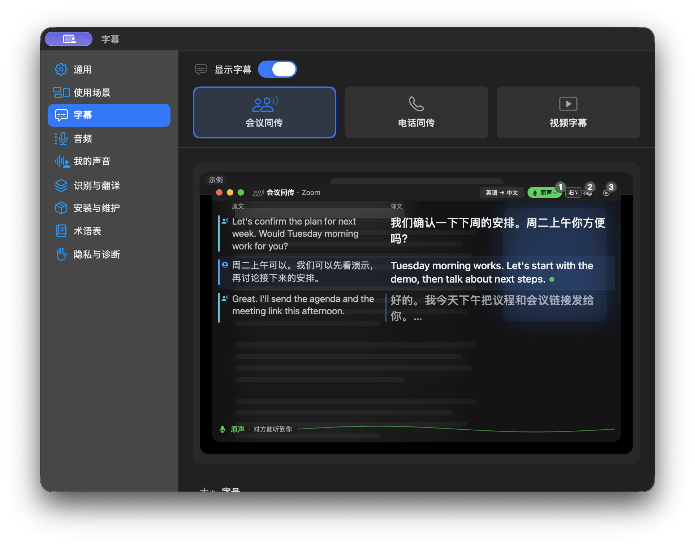

# TalkTalk



**在会议、电话和视频中使用中文、英语、德语字幕与语音翻译。**

TalkTalk 是一个原生 macOS 菜单栏应用。语音识别和语音合成在本机运行，文字翻译可选 OpenAI 或 Apple。可使用自己的声音生成译音，也可选择 macOS 系统声音。

## 三种使用场景

| 场景 | 用途与操作 |
|---|---|
| 会议同传 | 收听所选会议应用，显示原文与译文；通过 **TalkTalk Mic** 发送原声或翻译后的声音。 |
| 电话同传 | 固定连接 macOS **Phone**。先在 TalkTalk 准备，再到 Phone 拨号或接听；TalkTalk 结束同传不会挂断电话。 |
| 视频字幕 | 收听所选视频或浏览器应用，显示双语字幕；不启用麦克风，也不生成译音。浏览器来源覆盖该应用的音频，不是单独一个标签页。 |

- **收听字幕**支持中文、英语、德语之间六方向互译。三个场景分别记住声音来源与语言方向；电话来源固定为 Phone。
- **翻译发言**支持中文 → 英语／德语，以及英语 → 中文／德语。会议和电话各自选择发言语言，默认发送原声；点按 **右 ⌥** 开始翻译发言，再点按结束，剩余译音播完后恢复原声。
- **双语字幕**在会议和电话中按对话时间线显示；视频按句对显示并分页，草稿就地更新为定稿。有实际原文或译文后才显示视频字幕窗口。窗口可移动、缩放、隐藏或最小化；隐藏窗口不停止会话，新字幕不会擅自恢复用户收起的窗口。
- **本地声音克隆**复用录制的声音档案，可在 Qwen 与 Ming 之间切换；各模型分别保存声音缓存与试听音量校准。

界面支持中文和 English，可在 **设置 › 通用 › 界面语言** 中立即切换。界面语言与字幕、发言的语言设置相互独立。

## 开始使用

需要 **Apple Silicon Mac、macOS 26.4 或更新版本**。会议和电话同传请使用耳机。

**[下载 TalkTalk 1.0.15（macOS arm64 ZIP）](https://github.com/aaajiao/talktalk/releases/download/v1.0.15/TalkTalk-1.0.15-macOS-arm64.zip)** · [1.0.15 版本说明](https://github.com/aaajiao/talktalk/releases/tag/v1.0.15)

解压后将 `TalkTalk.app` 拖入“应用程序”，从 Finder 打开。该包使用 **ad-hoc 本地签名，尚无 Developer ID 签名及 Apple 公证**；首次打开时 macOS 可能显示安全提示或阻止启动，请确认下载来源后按系统提示处理。

首次设置：

1. 按首次引导授权，配置需要的语音资源。会议和电话还需要安装 **TalkTalk Mic** 虚拟麦克风；只看视频可走仅收听引导。
2. App 按需安装私有 Python 环境和本地模型，**无需自行安装系统 Python 或 Homebrew**。默认模型文件约 **4.1 GB**，另需运行环境空间；后续升级会复用兼容的运行时和已下载模型。
3. 在 **设置 › 使用场景** 选择会议、电话或视频，设置对应的应用与语言。会议／电话应用的输入需选择 **TalkTalk Mic**，或按引导跟随由 TalkTalk 管理的系统默认输入。
4. 如需云端文字翻译，填写自己的 OpenAI API key；使用 Apple 本地翻译前，需安装相应语言资源。
5. 如需用自己的声音，在 **我的声音** 中录制并试听。模型下载和删除在 **安装与维护**，已安装的合成模型在 **识别与翻译 › 语音合成** 中切换。

视频默认只收听所选应用；显式开启全局备用后会收听所有应用声音。会议中的静音仍由会议软件控制。停止同传或退出 TalkTalk 时，会还原它管理的系统输入。

## 本地模型与声音

默认仍使用 Qwen。语音资源提供三种安装组合，以下为模型文件体积，不含运行时或运行内存：

| 档位 | 语音合成 | 语音识别 | 文件体积 |
|---|---|---|---:|
| Max | Qwen3-TTS 1.7B | Qwen3-ASR 1.7B | 5.6 GB |
| 标准（默认） | Qwen3-TTS 1.7B | Qwen3-ASR 0.6B | 4.1 GB |
| 轻量 | Qwen3-TTS 0.6B | Qwen3-ASR 0.6B | 3.0 GB |

Qwen 使用固定的本地 8bit 模型。合成也可独立选择 **Ming-3.0-TTS 0.5B（BF16，约 3.0 GB）**，无需 Ming API。切换只更换语音合成模型，保留当前识别模型、翻译设置、字幕和播放流程，以及已下载的 Qwen 文件。

合成下拉菜单只列出本机已安装可用的模型；未安装的模型先在 **安装与维护** 下载，当前模型缺文件时可修复。切换需等当前会话、录音或试听结束；第一次使用另一模型时，会用已有录音建立该模型的声音缓存。

Apple Speech 在 **识别与翻译** 中独立选择，“听对方”和“我说话”分别保存选择，也可作为 Qwen 识别不可用时的备用。选择 Apple 不调用模型安装器、不更换合成模型；旧的仅语音合成安装保持兼容。

运行环境与模型位于 `~/Library/Application Support/TalkTalk/engine`。已下载的兼容模型会直接复用；删除模型需在安装与维护中确认，删除当前使用的模型不会自动切换到另一个已下载模型。

## 数据与隐私

| 环节 | 使用的模型或服务 |
|---|---|
| 声音 → 原文 | 本地 Qwen3-ASR，或 Apple Speech |
| 原文 → 译文 | OpenAI（需自己的 key），或 Apple Translation |
| 译文 → 声音 | 本地 Qwen3-TTS／Ming-3.0-TTS，或 macOS 系统声音 |

音频和声音档案在本机处理。启用 OpenAI 时，会发送原文、翻译上下文及术语表；API key 保存在 macOS 钥匙串。默认不保存会议录音或转写，转写记录、字幕分析和诊断录音需主动开启。

系统声音与第三方组件受各自许可约束，详见[许可说明](docs/decisions/licensing.md)。

## 从源码构建

需要 Xcode Command Line Tools（Swift 6.2+）：

```bash
git clone https://github.com/aaajiao/talktalk.git
cd talktalk
scripts/setup-dev-python.sh
scripts/check.sh --skip-stress
scripts/build-app.sh release
```

正式应用生成在 `build/TalkTalk.app`。打包脚本会自动递增构建号，正式发布版本号单独维护；本地构建不等于已发布的 GitHub Release。

当前私有运行时使用 **CPython 3.14.10**。App 包含引擎代码与安装器，解释器和依赖由 App 安装到专用目录，虚拟环境不读取系统 Python 包。开发环境使用仓库内 `.venv`，解释器固定在 `.build/dev-python`，与 App 共用模型 pins 和依赖锁文件；检查与打包前请先运行 setup。

`scripts/check.sh` 为每次检查创建独立临时目录并自动清理。Swift 文件夹具使用 `@Suite(.temporaryFiles)` 与 `TestTemporaryDirectory.make(prefix:)`，Python 使用 `TemporaryDirectory`；清理仅针对测试创建的文件。常规检查不替代真实麦克风、驱动、云端和通话验收。

## 开发与验证状态

本机声音录制、试听、Qwen／Ming 切换已有真实验证。长会议、电话远端听音、跨应用与跨设备兼容性仍按场景验收，不以本机合成或自动测试代替完整通话验证。

- [架构与开发约束](docs/ARCHITECTURE.md)
- [验收状态与剩余工作](docs/remaining-work.md)
- [历史验证记录](docs/validation-history.md)
- [维护、诊断与卸载](docs/maintenance.md)

## 许可证

项目代码采用 [MIT License](LICENSE)。第三方代码、模型和系统服务遵循各自许可证，见 [THIRD_PARTY_NOTICES](THIRD_PARTY_NOTICES.md)。
