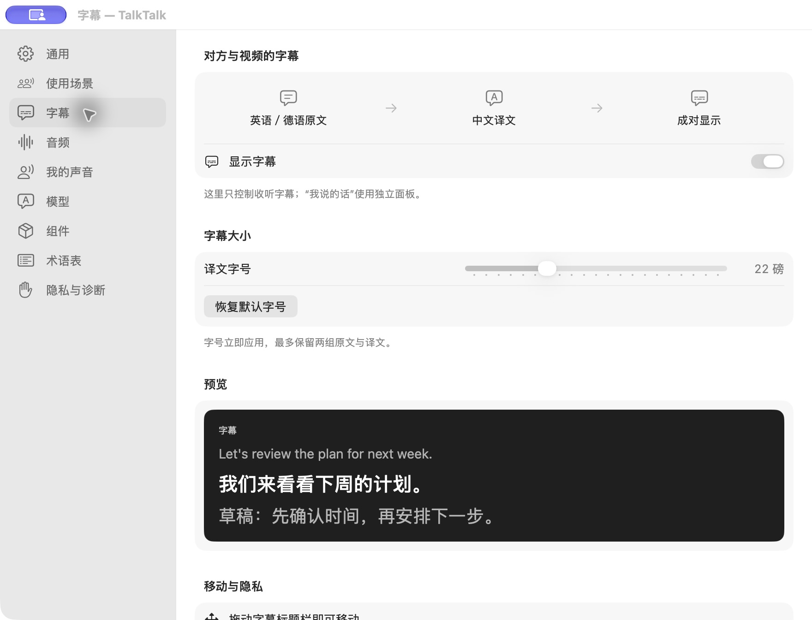

# TalkTalk

**让中文使用者更轻松地参与英语、德语会议，也能给视频加上双语字幕。**

TalkTalk 是一个原生 macOS 菜单栏应用。语音识别和语音合成在本机运行，文字翻译可选 OpenAI 或 Apple。

<p align="center">
  
</p>

*真实设置界面，字幕内容为内置预览。[查看会议同传流程](docs/images/meeting.jpg)。*

## 能做什么

- **听会议、看视频**：识别英语或德语，同时显示原文和中文译文；字幕可移动、可调字号，语言可随时切换。
- **用中文发言**：会议中默认发送原声；按住 **右 ⌥** 说中文（可夹英语），转换成英语或德语译音。松开后播完剩余译音，再恢复原声。
- **用自己的声音**：本地录制声音档案，由 Qwen 合成译音；会议软件选择 **TalkTalk Mic** 虚拟麦克风接收声音。

## 开始使用

需要 **Apple Silicon Mac、macOS 26.4 或更新版本**。会议同传请使用耳机。当前版本 **1.0.1**，此仓库提供源码，暂未发布经过 Developer ID 签名及公证的安装包。

```bash
git clone https://github.com/aaajiao/talktalk.git
cd talktalk
scripts/build-app.sh release
```

构建需要 Xcode Command Line Tools（Swift 6.2+）。将生成的 `build/TalkTalk.app` 拖入“应用程序”，然后打开：

1. 按首次引导授权，安装语音引擎及会议所需的虚拟麦克风。
2. 新机器会下载专用 Python 环境和 Qwen 模型；默认模型约 **4.1 GB**，另需运行环境空间。不依赖本机 Python，后续升级会复用兼容的模型。
3. 在菜单里选要听的应用及原文语言。看视频选“开始视频字幕”；开会选“开始会议同传”，并在会议软件里把输入设为 **TalkTalk Mic**。
4. 如需云端翻译，在设置里填写自己的 OpenAI API key；Apple 本地翻译需要先安装相应语言资源。

视频字幕只收听所选应用，不启用你的麦克风。会议中的静音仍由会议软件控制。

## 模型与隐私

| 环节 | 使用的模型或服务 |
|---|---|
| 声音 → 原文 | 本地 Qwen3-ASR；Apple Speech 可选及备用 |
| 原文 → 译文 | OpenAI（可选，需自己的 key）或 Apple Translation |
| 译文 → 声音 | 本地 Qwen3-TTS「我的声音」；可选 macOS 系统声音 |

音频和声音档案在本机处理。启用 OpenAI 时，会发送原文、翻译上下文及术语表；key 保存在 macOS 钥匙串。默认不保存会议录音或转写，文字分析和诊断录音需主动开启。系统声音与第三方组件受各自许可约束，详见[许可说明](docs/decisions/licensing.md)。

## 开发与状态

这是持续完善中的项目；不同会议软件的真实通话、音频路由和恢复行为仍需验证，不能将构建通过视为会议兼容性保证。

- [架构与开发约束](docs/ARCHITECTURE.md)
- [已知限制与剩余工作](docs/remaining-work.md)
- [维护、诊断与卸载](docs/maintenance.md)

常规检查：`scripts/check.sh --skip-stress`。实际麦克风、驱动、云端请求和通话检查需单独运行。

## 许可证

项目代码采用 [MIT License](LICENSE)。第三方代码、模型和系统服务遵循各自许可证，见 [THIRD_PARTY_NOTICES](THIRD_PARTY_NOTICES.md)。
